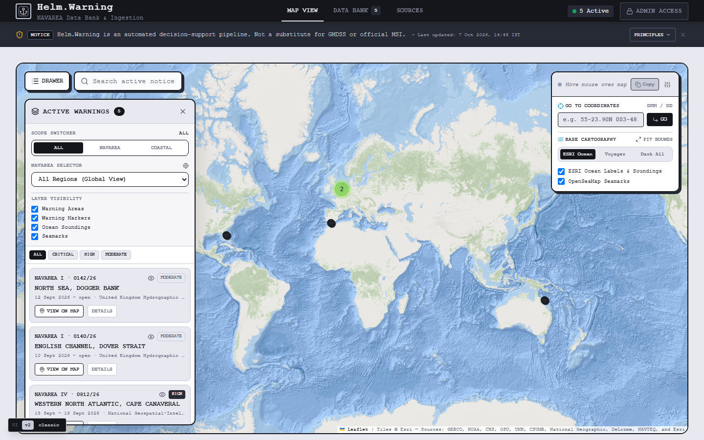
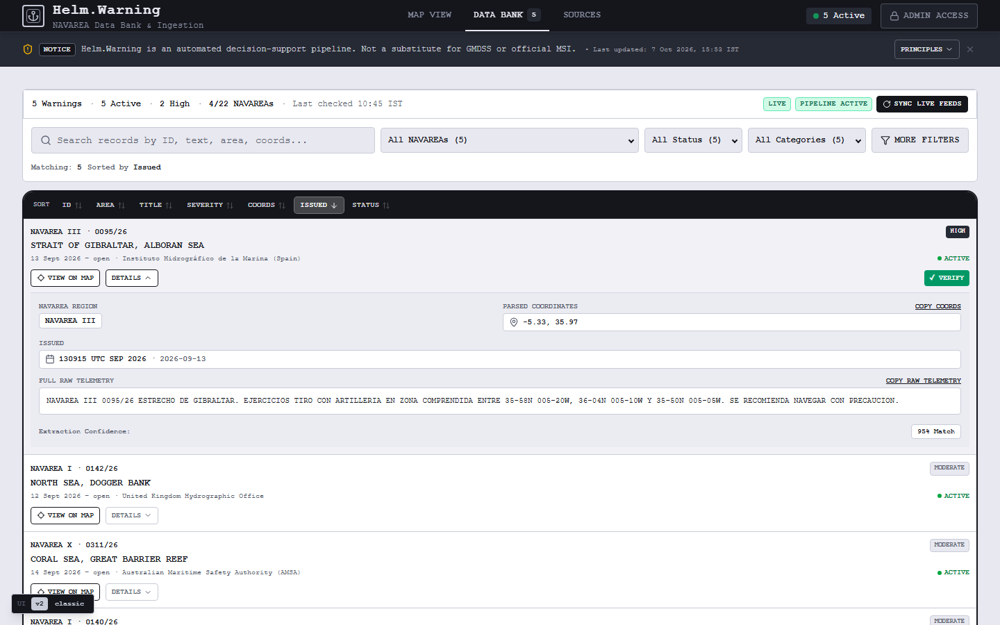
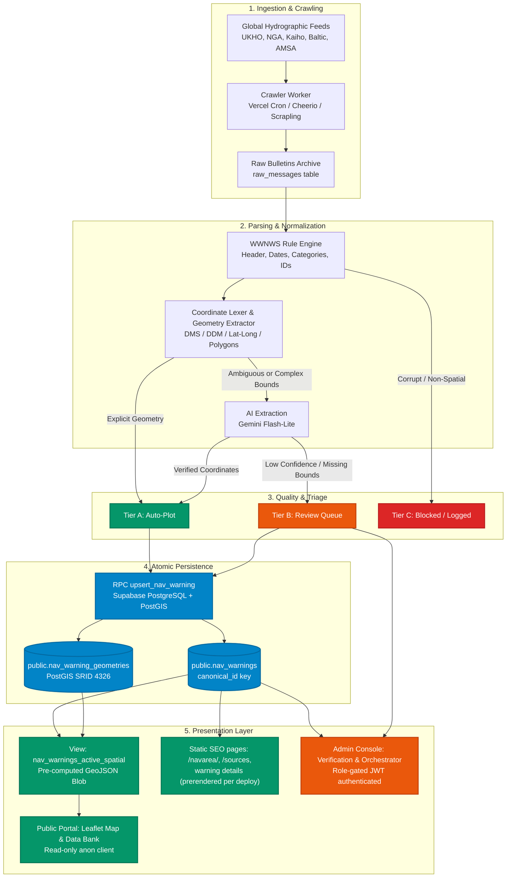

<div align="center">

<picture>
  <source media="(prefers-color-scheme: dark)" srcset="docs/brand/logofordark.svg">
  
</picture>

# ⚓ Helm.Warning

**Global NAVAREA Maritime Safety Information (MSI) Ingestion Pipeline & Chart Plotter**

[](https://helmwarning.vercel.app)

[](https://github.com/alfredpanakkal/helm.navwarning/actions/workflows/ci.yml)
[](https://github.com/alfredpanakkal/helm.navwarning/commits)

[](LICENSE)

<br/>

[](https://react.dev/)
[](https://www.typescriptlang.org/)
[](https://vitejs.dev/)
[](https://tailwindcss.com/)
[](https://leafletjs.com/)
[](https://expressjs.com/)
[](https://supabase.com/)
[](https://ai.google.dev/)
[](https://playwright.dev/)

</div>

---

Helm.Warning is an automated pipeline, spatial geometry visualizer, and navigational warning management platform for global **NAVAREA** maritime safety information (MSI). It continuously monitors national hydrographic offices, parses complex coordinate formats, normalizes polymorphic hazards (firing zones, drifting hazards, cable operations, offshore rigs), and visualizes them on nautical chart layers with bidirectional spatial synchronization.

---

## 🧭 Table of Contents

- [Overview & Screenshot](#-overview--visual-showcase)
- [System Architecture & Pipeline](#-system-architecture--pipeline)
- [Key Features](#-key-features)
  - [Public Portal (`/`)](#-public-portal-)
  - [Admin Console (`/admin`)](#-admin-console-admin)
  - [Static Public Pages & SEO](#-static-public-pages--seo)
- [Technology Stack](#-built-with-)
- [Database Contract & Security](#-database-contract--security)
- [Documentation Grid](#-documentation-grid)
- [Local Development & Setup](#-local-development--setup)
- [Development Changelog](#-development-changelog)
- [Brand & Logo Assets](#-brand--logo-assets)
- [Disclaimer](#-disclaimer)

---

## 📸 Overview & Visual Showcase

```
+------------------------------------------------------------------------------------------+
|  ⚓ Helm.Warning | NAVAREA Maritime Safety Information                     [Sources] [Admin] |
+------------------------------------+-----------------------------------------------------+
|  🗺️ INTERACTIVE MARITIME CHART     |  📋 FLOATING WARNINGS DRAWER / DATA BANK           |
|                                    |                                                     |
|  - Esri Ocean / Seamark Layers     |  - Real-Time Status Metric Strip                    |
|  - Polymorphic Vectors (Polygons,  |    (In-Force, Coverage %, Critical, Georeferenced)  |
|    Lines, Circles, Offshore Rigs)  |  - Inline Accordion Details (No Disruptive Modals)  |
|  - Antimeridian-Safe Projections   |  - Dual-Mode Minimize (44px) & Maximize Controls    |
|  - Live Clustering & Pins          |  - Bidirectional Focus: Pin Click <-> Card Scroll   |
+------------------------------------+-----------------------------------------------------+
```

| Desktop Chart & Floating Warnings Drawer | Inline Accordion Detail & Raw Bulletins |
|:---:|:---:|
|  |  |

---

## 🔄 System Architecture & Pipeline

The pipeline continuously cycles through hydrographic feed ingestion, rule-based coordinate normalization, resilient AI extraction, triage verification, and PostGIS spatial storage.



---

## ✨ Key Features

### 🌐 Public Portal (`/`)

- **Interactive Maritime Chart**: Powered by Leaflet.js with Esri Ocean Basemap, OpenSeaMap seamark overlay, and animated coordinate clustering.
- **Polymorphic Spatial Geometry Engine**:
  - Plots points, complex multi-vertex polygons, corridor buffers, firing exercise zones, and line strings.
  - Granular layer toggles for **Points**, **Polygons**, **Circles**, and **Lines**.
  - **Offshore Rig (MODU) Plotting**: Dedicated rig pins (`.nw-rig-pin`) with 500m (0.27 NM) safety exclusion perimeters and crosshairs.
- **Collapsible Floating Warnings Drawer**:
  - **Minimize (44px)**: Snaps the drawer down to leave an unobstructed nautical chart view.
  - **Maximize (520px / 75vh mobile)**: Expands for multi-hazard comparison and inspection.
- **In-Place Inline Accordions**: Click any hazard to expand full coordinate stamps, metadata chips, authority source tags, and raw immutable WWNWS text directly within the list—**no disruptive modals**.
- **Bidirectional Geo-Synchronization**:
  - Click **📍 Focus on Map** inside any warning to pan, center, and smoothly fit map bounds to the hazard envelope.
  - Click any map pin or geometry on the water to auto-scroll and highlight its corresponding card in the drawer.
- **Executive Data Bank Metrics Strip**: Real-time count of active in-force bulletins, NAVAREA coverage percentage, critical hazard tallies, and GPS georeferencing rate.
- **NAVAREA Data Bank**: Searchable and filterable by NAVAREA region (`NAVAREA I` through `XXI`, `BALTIC`), status, and category (`military`, `drifting`, `aton`, `subsea`, `offshore`, `electronic`, `general`).
- **Zero-Admin Decoupling**: Strictly read-only public bundle containing zero administrative endpoints, write handlers, or internal schemas.

### 🔐 Admin Console (`/admin`)

- **One admin URL**: `/admin` is a login gateway only — after Supabase sign-in it redirects to the React console at `/console`. The console itself is organized into **4 sections** with sub-tabs:
  1. **Warnings**: warning list, detail views with audit trail, geometry editing (undo/redo, diff banners, AMBIGUOUS confirm guard)
  2. **Ingest**: manual paste, CSV/import wizards, scraper + pipeline orchestration, pipeline-run ledger
  3. **Trace**: raw messages, generations, evidence, QA triage queue
  4. **System**: Supabase status/sync, AI connectivity (Gemini), source registry
- **Legacy hash aliases keep resolving**: old deep links (`#/map`, `#/databank`, `#/sources`, `#/imports`, `#/audit`, …) redirect to their canonical sections.
- **Role-Gated Supabase Authentication**: validates unalterable administrative JWT roles (`app_metadata.role`), verified server-side (`server/auth.ts`, fail-closed Bearer).
- **Hardened Defense-in-Depth**: `X-Frame-Options: DENY`, `noindex, nofollow, noarchive` robots directives, and CSP policies on both `/admin` and `/console`.

### 🧭 Static Public Pages & SEO

Beyond the interactive map, Helm.Warning publishes a fully static, crawlable public surface — all generated from one config module (`scripts/navarea-pages/navareaConfig.mjs`) with no SSR framework and no new serverless functions:

- **21 NAVAREA regional pages** (`/navarea/I` … `/navarea/XXI`): prerendered landing pages per region with region overview, official WWNWS coordinator details and a hydrated live in-force warning list (the existing anon Supabase read path). Invalid region IDs are genuine 404s.
- **Source Registry** (`/sources`): one clickable card per NAVAREA region with its waters and area coordinator, linking to every regional page. Fully static — no hydration scripts, the whole registry is in the initial HTML.
- **Warning detail pages** (`/navarea/<RN>/warning/<num>-<year>`): one static page per active warning carrying the **complete original bulletin text in the initial HTML**, plus region, status, validity, geometry tier and coordinator metadata. The slug derives from the warning's `canonical_id`, so `NA`/`NAVAREA` prefix variants resolve to the same URL.
- **Per-deploy prerendering**: `npm run build` runs the generator (`scripts/navarea-pages/`) as its first step — it reads active warnings through the public anon Supabase REST endpoint (fail-open: a database error never breaks a deploy) and rewrites fresh detail pages on every deploy, deleting stale ones.
- **No-404 shell fallback**: warnings ingested after the last deploy are served through the `/warning-shell` rewrite + client-side hydration (`noindex` until the next deploy prerenders them). The Vercel 12-function cap is respected — no new `api/**` functions.
- **SEO plumbing**: `sitemap.xml` regenerated on every build (static routes + every active warning detail URL), robots and `X-Robots-Tag: noindex` hardening on `/admin` and `/console`, and canonical URL + OpenGraph + `BreadcrumbList` JSON-LD on all public pages.

## 🔧 Built With

| Technology | Version | Purpose in Helm.Warning |
|---|---|---|
| **[React](https://react.dev/)** | `19.0.1` | Component architecture for reactive map overlays, drawer controllers, and Data Bank table |
| **[TypeScript](https://www.typescriptlang.org/)** | `5.9.3` | End-to-end type safety across WWNWS warning schemas, PostGIS geometry types, and API payloads |
| **[Vite](https://vitejs.dev/)** | `6.2.3` | Ultra-fast client bundler configured for multi-page builds (`index.html` + `admin.html`) |
| **[Tailwind CSS](https://tailwindcss.com/)** | `4.1.14` | High-performance styling system utilizing strict design tokens for maritime status codes |
| **[Leaflet](https://leafletjs.com/)** | `1.9.4` | Interactive hydrographic map renderer with custom vector layers, marker clustering, and bounds animation |
| **[Express](https://expressjs.com/)** | `4.21.2` | Full-stack server providing SSRF-guarded proxies, rate limiting, and dev middleware |
| **[Supabase](https://supabase.com/)** | `2.116.0` | PostgreSQL with PostGIS extension for spatial queries, RLS policies, and real-time subscriptions |
| **[Google Gemini](https://ai.google.dev/)** | `2.4.0` | `@google/genai` Flash-Lite integration for zero-shot maritime coordinate and bounding-box extraction |
| **[Playwright](https://playwright.dev/)** | `1.63.0` | Automated visual regression suite and UX smoke test harness (`scripts/ux-audit/`) |

---

## 🔒 Database Contract & Security

Helm.Warning strictly implements the **20261019/20 schema contract** documented in [`docs/supabase-backend-contract.md`](docs/supabase-backend-contract.md).

```
┌──────────────────────────────────────┐       1:N       ┌─────────────────────────────────────┐
│         public.nav_warnings          │ ─────────────── │    public.nav_warning_geometries    │
├──────────────────────────────────────┤                 ├─────────────────────────────────────┤
│ id (UUID, PK)                        │                 │ geom_id (UUID, PK)                  │
│ canonical_id (TEXT, UNIQUE)          │                 │ warning_id (UUID, FK)               │
│ navarea (TEXT, 'NAVAREA XI'...)      │                 │ feature_type (POINT|POLYGON|...)    │
│ title, area_text, raw_text           │                 │ geom_postgis (geography, SRID=4326) │
│ status (active|cancelled|expired...) │                 │ zone_label, buffer_nm               │
│ categories (TEXT[])                  │                 └─────────────────────────────────────┘
│ triage_tier (A | B | C)              │
│ data_quality, parsing_method         │
│ valid_from, valid_to, issued_at      │
└──────────────────────────────────────┘
                   │
                   ▼
┌────────────────────────────────────────────────────────┐
│         public.nav_warnings_active_spatial (VIEW)      │
├────────────────────────────────────────────────────────┤
│ Pre-computed ST_AsGeoJSON (geojson_blob) for Leaflet   │
│ Filtered to active + Tier A warnings                   │
└────────────────────────────────────────────────────────┘
```

### Row Level Security (RLS) Matrix

Live state as of 2026-10-24 (post-hardening; RLS enabled on all tables):

| Table / View | Public (`anon`) | Admin (JWT, role-gated) | Service Role (pipeline) |
|---|---|---|---|
| `public.nav_warnings` | `SELECT` (active only) | `INSERT` / `UPDATE` (admin-gated) | `ALL` |
| `public.nav_warning_geometries` | `SELECT` | `ALL` (admin-gated) | `ALL` |
| `public.nav_warnings_active_spatial` | `SELECT` | `SELECT` | `SELECT` |
| `public.raw_messages` | `SELECT` | `SELECT` | `ALL` |
| `public.nav_warning_audits` | ❌ No access | `INSERT` / `SELECT` (append-only: UPDATE and DELETE denied) | `ALL` |
| `public.pipeline_runs` | ❌ No access | `SELECT` / `INSERT` / `UPDATE` (admin-gated; DELETE denied) | — |

**No table grants writes to `authenticated` at large** — only the role-gated admin policies above.

### Key Architectural Safeguards
1. **No Geometry in `nav_warnings`**: Spatial coordinates live exclusively in `nav_warning_geometries` (PostGIS) or the pre-computed `geojson_blob` column of the `nav_warnings_active_spatial` view.
2. **Stable Canonical Identity**: All cross-references and updates use `canonical_id` (e.g., `NAVAREA XI 0451/26`).
3. **SSRF Guard (`server/ssrfGuard.ts`)**: Outbound evidence enrichment strictly resolves and validates DNS against RFC 1918 internal blocks and limits response sizes to 2MB.
4. **Anonymous Tile Proxy**: Basemap proxies prevent client-side credential exposure and enforce IP rate limits.

---

## 📚 Documentation Grid

| Document | Focus & Purpose |
|---|---|
| 📋 [**PRD.md**](PRD.md) | Product Requirements Document, user personas, operational scope, and acceptance criteria |
| 📐 [**DESIGN.md**](DESIGN.md) | Technical architecture, component boundaries, state flow, and design tokens |
| 🗄️ [**docs/supabase-backend-contract.md**](docs/supabase-backend-contract.md) | Authoritative database schema contract, column specifications, and query cheat-sheet |
| 🛡️ [**AGENTS.md**](AGENTS.md) | Operational rules, design tokens, non-negotiables, and security conventions |
| 🧪 [**docs/archive/UI_UX_AUDIT_REPORT.md**](docs/archive/UI_UX_AUDIT_REPORT.md) | Archived visual audit report (2026-10-17; superseded snapshot) |
| 💾 [**docs/supabase_setup.sql**](docs/supabase_setup.sql) | DDL migrations, PostGIS indexes, and RLS policies for PostgreSQL |
| 📝 [**docs/archive/CODE_REVIEW.md**](docs/archive/CODE_REVIEW.md) | Archived code review (2026-10-06; findings resolved by roadmap #6) |

---

## 🛠️ Local Development & Setup

### Prerequisites
- **Node.js**: v20+ or v22 LTS
- **npm**: v10+

### 1. Clone & Install
```bash
git clone https://github.com/alfredpanakkal/helm.navwarning.git
cd helm.navwarning
npm install
```

### 2. Configure Environment
```bash
cp .env.example .env
```
Configure your `.env` variables:
```ini
# Supabase Connectivity
SUPABASE_URL=https://your-project.supabase.co
SUPABASE_PUBLISHABLE_KEY=your-anon-public-key
SUPABASE_SECRET_KEY=your-service-role-key

# Scraper & Ingestion Security
CRON_SECRET=your-cron-secret-token

# AI Feature Extraction
GEMINI_API_KEY=your-gemini-api-key

# Optional Basemap Key
CARTO_API_KEY=your-optional-carto-key
```

### 3. Available Scripts

| Command | Action |
|---|---|
| `npm run dev` | Starts local Express server with live Vite middleware on `http://localhost:3000` |
| `npm run lint` | Runs TypeScript typecheck (`tsc --noEmit`) |
| `npm test` | Runs unit tests using Vitest across parsing and geometry modules |
| `npm run build` | Builds Vite client production bundle and compiles `server.ts` to `dist/server.cjs` |
| `npm start` | Starts the compiled production Node.js server |
| `npm run ux:capture` | Launches Playwright to capture DOM snapshots and viewport screenshots |
| `npm run ux:smoke` | Executes end-to-end browser regression smoke tests |

---

## 📋 Development Changelog

<details>
<summary><b>Click to expand recent milestones and engine updates</b></summary>
<br/>

### Phase 2 — Search-Friendly Public Surface (2026-10-25)
- **Static public pages shipped**: 21 prerendered NAVAREA regional pages (`/navarea/I`…`/navarea/XXI`), the Source Registry hub (`/sources`), and one static page per active warning (`/navarea/<RN>/warning/<num>-<year>`) whose **complete original bulletin text ships in the initial HTML** — individual warnings are now crawlable, not just the region indexes.
- **Crawl-safe freshness**: detail pages are prerendered on every deploy from the public anon Supabase read (fail-open; stale pages removed); warnings newer than the last deploy fall back to the `noindex` `/warning-shell` rewrite instead of 404ing, and `sitemap.xml` is regenerated per build with every active warning URL.

### Multi-Area, Multi-Sector & Offshore Rig Spatial Plotting Engine
- **Polymorphic Spatial Layers**: Isolated Leaflet `LayerGroup` instances (`pointsLayer`, `polygonsLayer`, `circlesLayer`, `linesLayer`) with granular toggle checkboxes in the maritime overlays panel. Full support for `Polygon`, `MultiPolygon`, `LineString`, `MultiLineString`, and `Circle` geometries with auto-calculated geographic bounding boxes.
- **Multi-Area & Sector Segmentation**: Upgraded parser to split discrete sub-blocks: `AREA [A-Z0-9]+` (*Area Alfa*, *Area Bravo*), `SECTOR [A-Z0-9]+`, `SUB-AREA`, `ZONE`, `FIRING AREA`, and parenthetical markers `(A), (B)`. Each sub-area/sector is plotted as an independent vector geometry with its own label and square nautical miles area badge.
- **Offshore Rig (MODU / Drilling Platforms)**: Parses multiple rig listings from RIGLIST bulletins (e.g., *VALARIS 120*, *NOBLE PROSPECT*, *STENA DON*). Plots each rig with a dedicated offshore platform pin (`.nw-rig-pin`) alongside a 500m (0.27 NM) dashed safety exclusion perimeter circle and center crosshair.
- **Global Navigation View**: Default view set to *All NAVAREAs (Global View)* with automatic `fitBounds` calculation across all live hazard envelopes.

### Database Ingestion & PostGIS Synchronization (Milestone M1)
- **Service Role Direct Sync**: `syncWarningsToSupabase` pipeline worker utilizes the Supabase Service Role key to bypass RLS for automated background ingestion.
- **Sentinel Interception**: Automatically catches `depth_m == -9999.0` sentinel values and converts them to `NULL` to satisfy the `chk_shoal_depth_sentinel` database constraint.
- **Relational Batch Processing**: Atomically inserts warning envelopes into `public.nav_warnings` and captures returned UUID primary keys to execute batch child inserts into `nav_warning_geometries`.

### UX Navigation & Interactive Drawer Modernization
- **Collapsible Floating Warnings Panel**: Dual-mode minimize (44px) and maximize (520px / 75vh mobile) controls for seamless chart exploration.
- **In-Place Inline Accordions**: Direct warning detail expansion without modal popups.
- **Bidirectional Sync**: Smooth two-way synchronization between map clicks and warning list items.
- **Real-Time Data Bank Metrics Strip**: Real-time summary strip tracking active warnings, global coverage, critical alerts, and georeferencing percentage.

</details>

---

## ⚓ Brand & Logo Assets

Theme-aware full logo — auto-switches with your GitHub color scheme (light version shown below; white version on dark):

<picture>
  <source media="(prefers-color-scheme: dark)" srcset="docs/brand/logofordark.svg">
  
</picture>

Header monogram mark (rendered black here; in app headers it uses `fill="currentColor"` at 24px and inherits each app's text/accent color):


| Asset | File | Usage |
|---|---|---|
| Full logo — light theme (black `#000000`) | [`docs/brand/logoforlight.svg`](docs/brand/logoforlight.svg) | Light backgrounds |
| Full logo — dark theme (white `#FFFFFF`) | [`docs/brand/logofordark.svg`](docs/brand/logofordark.svg) | Dark backgrounds |
| Monogram mark | [`docs/brand/helm-monogram.svg`](docs/brand/helm-monogram.svg) | App headers, favicons, avatars (`currentColor`) |

---

## 📜 Disclaimer

*Helm.Warning is an automated decision-support and visualization tool. It is not an official Maritime Safety Information (MSI) distributor and is not a replacement for the Global Maritime Distress and Safety System (GMDSS) or official hydrographic publications issued by national authorities.*
